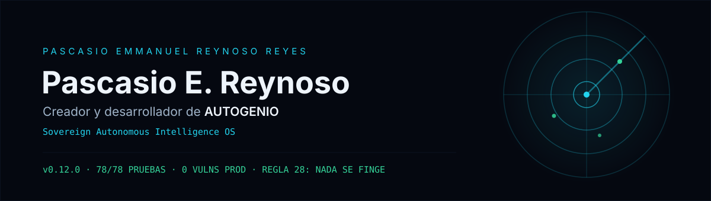

 

## Qué construyo

**[AUTOGENIO](https://github.com/pascasio01/autogenio)** — *Sovereign Autonomous Intelligence OS*.
Misiones multiagente con control humano, evidencia verificable y ejecución real.
Sin demos. Sin simulaciones. Cada cifra sale de una medición o de la base de datos.

| | |
|---|---|
| **Stack** | React 19 · TypeScript · tRPC 11 · Hono · Drizzle ORM · MySQL |
| **Núcleo** | Motor de misiones con puerta de evidencia · Trust Kernel SHA-256 · Approval Engine |
| **IA** | Model Router con `LOCAL ONLY` real · Resource Guardian · Agent Factory (10 agentes) |
| **Calidad** | 78/78 pruebas · `tsc` estricto · 0 vulnerabilidades en dependencias de producción |
| **Estado** | v0.12.0 · desarrollo activo · repositorio privado, acceso por invitación |

 

## Cómo trabajo — Regla 28

> Cada capacidad declarada está implementada y verificada, o etiquetada honestamente
> con su estado (`VERIFIED` / `SPECIFIED`). Si el sistema no tiene GPU, dice que no
> tiene GPU. Si la red no se mide, la red no aparece.

La matriz de honestidad no vive en un PDF: vive dentro de la propia aplicación,
visible para cualquiera que la use.

 

## Stack

 

## También

**TuDoctor24/7** — plataforma de salud con IA. [tudotor247.com](https://tudotor247.com)

 

## Contacto

pascasio01@gmail.com · Los reportes de seguridad de AUTOGENIO siguen el canal privado de su [SECURITY.md](https://github.com/pascasio01/autogenio/blob/master/SECURITY.md).

 

Sin demos. Sin simulaciones. — <b>Regla 28</b>

